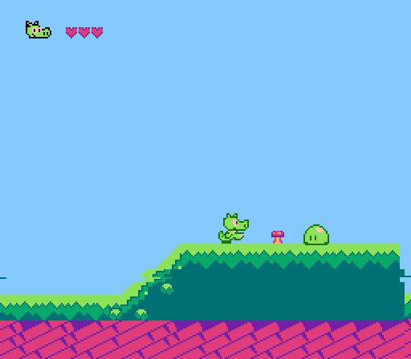
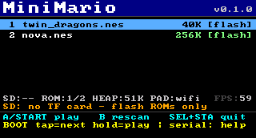
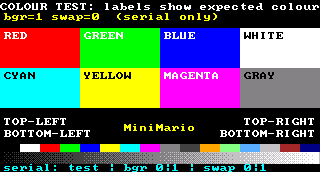
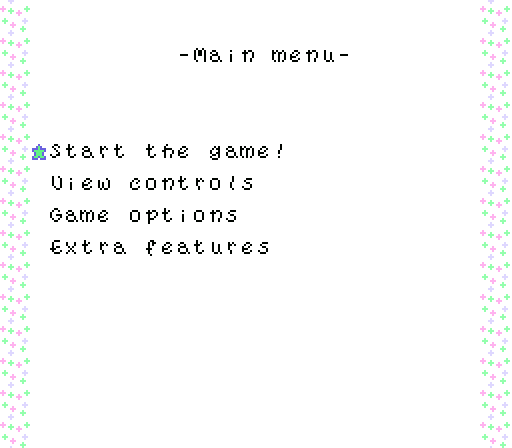
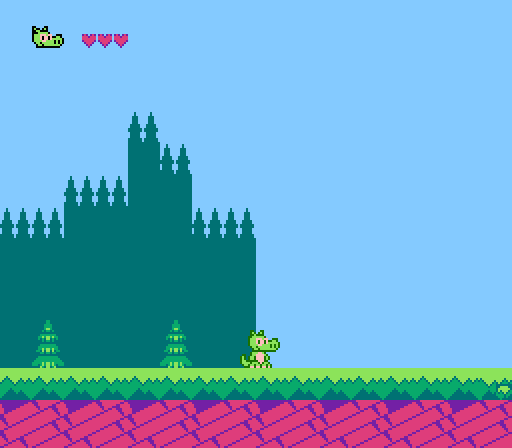
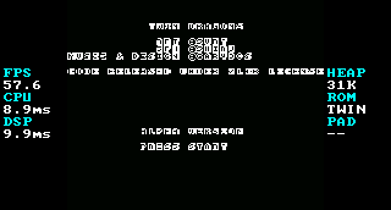

# MiniMario — 给 Waveshare ESP32-C6-LCD-1.47 的 NES（FC）模拟器

把一块 **Waveshare ESP32-C6-LCD-1.47**（ESP32-C6FH4，1.47 寸 ST7789 172×320 屏，TF 卡槽，BLE 5）做成一台迷你 NES 掌机：
横屏 320×172 输出、蓝牙 BLE 手柄操作、ROM 从 TF 卡或片内 Flash 加载。

> 本仓库是完整可编译工程 + 已烧录固件 + 主机端工具。没有内置任何任天堂版权 ROM。



| 菜单 | 显示校准图 |
|---|---|
|  |  |

---

## 1. 功能

- **nofrendo 内核**（GPLv2），43 种 Mapper（0/1/2/3/4/5/7/…/231），iNES 格式
- **横屏 320×172**，软件转置输出到 172×320 面板，三种缩放：
  - `FIT`：等比 4:3，居中 210×172（默认，推荐）
  - `FILL`：拉伸铺满 320×172（画面更满，比例略有拉伸）
  - `PIXEL`：方像素，居中 197×172
- **4 种屏幕方向**（rot 0/1/2/3），保存在 NVS
- **蓝牙 BLE 手柄**（Bluepad32 v4.2.0，BTstack）+ 无手柄时的备用手动输入
- **ROM 来源**：TF 卡 `/sdcard/*.nes`，或片内 1.9 MB `roms` 分区（出厂内置 2 个免费开源游戏）
- **游戏画面两侧实时状态栏**：FPS / 模拟耗时 / 显示耗时 / 空闲内存 / ROM / 输入源
- **串口调试控制台**：截图（`shot`）、改方向/缩放/背光、注入按键、查看 fps/内存
- **无音频**：这块板子没有 DAC / 功放 / 喇叭，因此固件不输出声音（模拟器也不消耗 APU 采样算力）

## 2. 硬件

| 项目 | 参数 |
|---|---|
| MCU | ESP32-C6FH4，RISC-V 单核 **160 MHz**，**512 KB SRAM**，**4 MB Flash**，**无 PSRAM** |
| 屏幕 | ST7789，172×320，SPI2 @ **80 MHz**（MOSI 6 / SCLK 7 / CS 14 / DC 15 / RST 21 / BL 22） |
| TF 卡 | 与屏共用 SPI：MISO 5 / CS 4（20 MHz SDSPI） |
| 按键 | BOOT = GPIO9（**单键即可操作整个界面**；游戏中作 A 键） |
| 蓝牙 | BLE 5 only（**没有**经典蓝牙 BR/EDR） |

## 3. 开箱使用（固件已烧录）

上电 → 出现菜单 → 方向键选择 → A 开始，START+SELECT 退出回菜单。

内置免费游戏（可直接玩，无需 TF 卡）：

| 游戏 | 类型 | 大小 | 许可 |
|---|---|---|---|
| [Twin Dragons](https://github.com/Garydos/twin-dragons-nes) | 横版过关（马里奥 3 风格） | 40 KB | 代码 zlib，美术 CC-BY 3.0 |
| [Nova the Squirrel](https://github.com/NovaSquirrel/NovaTheSquirrel) | 横版解谜平台 | 256 KB | 代码 GPLv3，素材 CC-BY-NC-SA 4.0 |

| Nova the Squirrel（Mapper 1，flash mmap） | Twin Dragons 游戏中 |
|---|---|
|  |  |

### 3.1 游戏画面两侧的实时状态栏

`FIT` / `PIXEL` 缩放时游戏画面两侧有留白，以前会残留菜单画面；现在这两条留白改成
实时状态栏，每秒刷新 2 次（`scale FILL` 铺满全屏时没有留白，自然不显示）：



| 左栏 | 含义 | 右栏 | 含义 |
|---|---|---|---|
| `FPS` | 模拟器实际帧率（NTSC 60.0988 为标准值） | `HEAP` | 当前空闲堆内存（KB） |
| `CPU` | 平均每帧模拟耗时（不含刷屏），单位 ms | `ROM` | 当前 ROM（最多 6 个字符） |
| `DSP` | 平均每帧刷屏耗时（转换 + SPI），单位 ms | `PAD` | 输入源：`BT` 蓝牙手柄 / `WIFI` 手机网页 / `--` 无 |

状态栏只在文字变化时重画那 110 行（约 4 ms，2 Hz），对帧率影响 < 0.6%。
串口调试时可以用 `shotui` 导出这块 UI 画布（游戏运行中也能截）。

## 4. 手柄

### 4.1 只用 BOOT 一个键（没有手柄 / 手机也能操作）

板子上只有一个可用按键（BOOT，GPIO9），所以固件把整个界面做成了**单键操作**：

| 当前界面 | 操作 | 效果 |
|---|---|---|
| 菜单 | **短按**（< 0.6 秒） | 光标移到下一个 ROM（到列表末尾自动回到第一个） |
| 菜单 | **长按**（≥ 0.8 秒） | 启动当前选中的 ROM |
| 游戏 | **按住** | A 键（跳跃/确认） |
| 游戏 | **双击**（两下间隔 < 0.4 秒） | START 键（用来过 "PRESS START" 标题画面） |
| 游戏 | **长按**（≥ 1.5 秒） | 退出游戏，回到菜单 |

菜单底部会显示提示：`BOOT tap=next hold=play`。
旧的「BOOT 直接等于 A 键」的兜底逻辑已经关闭，避免按 BOOT 时在菜单里误启动游戏。

> 想确认按键逻辑而手边不方便按？串口控制台可以注入事件：
> `boot tap`（短按）、`boot hold`（长按）、`boot double`（双击）。

### 4.2 重要：C6 只支持 BLE 手柄

ESP32-C6 的蓝牙是 **Bluetooth LE 5 only**，没有经典蓝牙（BR/EDR），所以：

| 手柄 | 能否连接 | 说明 |
|---|---|---|
| Xbox One S / Series X\|S（固件 5.x 以上） | ✅ | 推荐，按住配对键进入配对 |
| Xbox Adaptive | ✅ | BLE |
| Steam Controller（刷 BLE 固件后） | ✅ | |
| Stadia 手柄（刷 BLE 固件后） | ✅ | |
| 部分 Android / 通用 BLE HID 手柄 | ⚠️ | 走通用 HOGP 解析，看具体型号 |
| PS5 DualSense / PS4 / PS3 | ❌ | 只有 BR/EDR，硬件层面不支持 |
| Switch Pro / Joy-Con / Wii | ❌ | 只有 BR/EDR |
| 8BitDo（普通蓝牙模式） | ❌ | 8BitDo 经典模式是 BR/EDR；个别型号的 BLE 模式可能可用 |

> 如果你的手柄不是 BLE 的，还有两条路：① 用 USB 线把板子连电脑，用 `tools/serial.py -s "key ..."` 或控制台注入按键（可脚本化）；② 后续可以用 PC 转接（把 PC 上的任意手柄转成串口按键）。


### 4.3 按键映射

| NES | Xbox (BLE) | 通用 BLE HID | 备用 |
|---|---|---|---|
| A | A | A / 南键 | **BOOT 按住**（见 4.1）、串口 `key a` |
| B | B | B / 东键 | 串口 `key b` |
| Start | Menu | Start | 串口 `key start` |
| Select | View | Select | 串口 `key select` |
| 方向 | 十字键/左摇杆 | 十字键/左摇杆 | 串口 `key up/down/left/right` |
| 退出游戏 | Start+Select（1.5 秒） | 同左 | 串口 `quit` |

配对：手柄进入配对模式（Xbox：按住手柄顶部配对键 3 秒直到灯闪），板子上电后自动扫描连接。
连接后串口会打印 `gamepad: connected ...`。

### 4.4 手机当手柄（Wi-Fi 网页虚拟手柄，推荐）

不需要装 App，iPhone / Android 都能用：

1. 串口控制台执行 **`wpad on`**（会记住，以后开机自动开；`wpad off` 关闭）
2. 手机 Wi-Fi 连接热点：**SSID `MiniMario-Pad`（开放网络，无密码）**
3. 手机浏览器打开 **http://192.168.4.1/** → 出现虚拟十字键 + A/B/Start/Select，直接玩（横屏更好）

页面顶部会显示「板子收到: 0x..」——按按钮时这个数值变化说明指令已经到达板子（这是最快的排障手段）。
固件内置自检（不需要手机）：`wpad test` → 正常输出
`OK wpad selftest: http status=200 page=ok (6817/6817 bytes) websocket=ok keepalive=ok`
实测 Wi-Fi 热点运行中模拟器仍 **59.99 fps**；手机断开 1.2 秒后按键自动释放。详见
[components/phone_pad/README.md](components/phone_pad/README.md)。

> 连板子热点时手机不能上网；个别 Android 机在"无互联网"时会切回移动数据，需在 Wi-Fi 设置里关闭自动切换。

### 4.5 蓝牙键盘当手柄（仅 Android，可选）

固件同时支持 **BLE HID 键盘**：在安卓手机装一个 "BLE HID 键盘" 类 App（把手机模拟成蓝牙键盘），
板子会自动把它当控制器连接。键位：

| 键盘 | NES |
|---|---|
| 方向键 / WASD | 十字键 |
| Z / J / 空格 | A |
| X / K | B |
| Enter | Start |
| Backspace / Esc | Select |

（iPhone 不支持 App 模拟蓝牙外设，所以这条路只对 Android 有效。）

## 5. 添加你自己的 ROM（例如 Super Mario Bros.）

> **本固件不附带任何任天堂版权 ROM。** 请使用你自己合法拥有的卡带 dump。
> Super Mario Bros. 是 iNES **Mapper 0**，本模拟器完全支持（实测同 mapper 的 Twin Dragons 满帧运行）。

### 方式 A：TF 卡（最简单）

1. TF 卡格式化为 FAT32；
2. 把 `*.nes` 复制到卡根目录；
3. 插卡上电，菜单出现 `[sd]` 条目，选中即玩；
4. 热插拔后可 `rescan` 重新扫描。

> 当前测试机上没有插 TF 卡（`sd=absent`），插卡后会自动出现。

### 方式 B：烧进片内 Flash（不需要 TF 卡）

```bash
# 单个 ROM：直接放在 roms 分区开头（legacy 格式，最快）
python tools/flash_rom.py /path/to/supermario.nes

# 多个 ROM：打包成 MMROM1 容器（菜单里会列出多个条目）
python tools/pack_roms.py twin_dragons.nes nova.nes supermario.nes -o roms.bin
python tools/flash_rom.py --container roms.bin
```

> 片内 `roms` 分区 1.9 MB，用的是 flash mmap，不占 512 KB SRAM。
> TF 卡的 ROM 会读进堆内存，上限 256 KB（更大的请用方式 B）。

## 6. 串口控制台

USB 线连接电脑（板子原生 USB-Serial-JTAG），设备是 `/dev/ttyACM0`（Windows 为 COMx），波特率随意：

```
help                      命令列表
info                      芯片/内存/fps/画面信息
roms                      ROM 列表
play <n|flash|path>       启动 ROM（菜单序号 / 片内 flash / TF 卡路径）
menu | quit               返回菜单
up/down/select/rescan     菜单操作
key <a|b|select|start|up|down|left|right|none> [+ ...]   注入手柄按键
pad                       查看当前按键
boot tap|hold|double      模拟 BOOT 按键短按/长按/双击（测试）
rot <0-3>                 屏幕方向（0/2 竖屏，1/3 横屏），存 NVS
scale <0-2>               0=FIT 1=FILL 2=PIXEL
bl <0-100>                背光
bgr <0|1>                 颜色顺序 RGB/BGR（默认 1=BGR；也可双击 BOOT 进校准图）
wpad on|off|status|test   手机 Wi-Fi 手柄开关 / 状态 / 自检
wpad press <hex> [ms]     模拟手机按键（如 01=A、0c=Start+Select），自动化测试用
test                      显示颜色校准图（也可在菜单双击 BOOT）
shot                      截图（二进制帧 + 调色板）
shotui                    导出 UI 画布（游戏运行时含两侧状态栏）
ping | reboot
```

### 截图（用于检查/存档）

```bash
python tools/shot.py -o frame.png --scale 2     # 游戏画面 -> PNG
python tools/shot.py -o menu.png               # 菜单画面 -> PNG
python tools/shot.py --json                    # 元数据
python tools/serial.py -s "key right+a"        # 注入按键
```

### 屏幕方向 / 颜色不对怎么办

**不用电脑、只有 BOOT 键也能校准颜色：**

1. 菜单里**双击 BOOT**（两下间隔 < 0.4 秒）→ 屏幕出现颜色测试图：
   8 个色块（RED / GREEN / BLUE / WHITE / CYAN / YELLOW / MAGENTA / GRAY），
   块上的英文就是它**应该**显示的颜色；顶部一行显示当前设置（如 `bgr=1 swap=0`）。
2. **短按 BOOT** = 切换 BGR ⇄ RGB（每按一次重画）。
3. **双击 BOOT** = 切换 RGB565 字节序（`swap` 0 ⇄ 1）。
4. 调到色块和标签一致后，**长按 BOOT** 退出。设置存进 NVS，重启/换 ROM 都保留。

有串口时等价命令：

- `test` 显示颜色测试图；`bgr 0|1` 切换颜色顺序；`swap 0|1` 切换字节序；`pal` 查看当前值。
- 图不是正的：`rot 0` / `rot 1` / `rot 2` / `rot 3`（存 NVS）。
- 画面位置/宽度不对：`scale 0/1/2`。

**本机实测默认值：`bgr=1`、`swap=0`。**

> 说明：这块 1.47" 屏是 **BGR 排线**（Waveshare 自家 TFT_eSPI 配置里也是
> `TFT_RGB_ORDER = TFT_BGR`），MADCTL 必须置 BGR 位，否则**红蓝互换**——
> 表现就是"青色显示成黄色、蓝色显示成红色"。
> `swap` 是 RGB565 两个字节的发送顺序，本机保持 0（按原字节序），
> 换到其它批次/其它面板若整体颜色错乱，可以在校准图里双击 BOOT 试 1。

## 7. 固件文件（firmware/）

本目录里的 `firmware/` 是已经在本机验证并烧录过的成品：

| 文件 | 说明 |
|---|---|
| `MiniMario-full-esp32c6.bin` | **完整镜像**（bootloader + 分区表 + app + 内置 ROM），一条命令烧录 |
| `MiniMario-app.bin` | 仅应用（0x10000） |
| `roms.bin` | 内置 ROM 容器（0x1F0000） |
| `flash_all.sh` | 一键烧录脚本 |

```bash
cd firmware && ./flash_all.sh /dev/ttyACM0      # 或者
python -m esptool --chip esp32c6 -p /dev/ttyACM0 write_flash 0x0 MiniMario-full-esp32c6.bin
```

> 说明：本文档里的游戏截图是**从设备串口导出的 NES 帧缓冲转成 PNG** 的（`tools/shot.py`），
> 证明模拟器和渲染链路正确；物理屏幕的方向/镜像/颜色请用 `test` 校准图在真机上确认
> （见第 6 节），不对就用 `rot` / `bgr` 调整。

## 8. 编译

需要 ESP-IDF v5.3.x（本项目在 v5.3.2 验证）。

```bash
source ~/esp/esp-idf/export.sh
idf.py set-target esp32c6
idf.py build
idf.py -p /dev/ttyACM0 flash
```

烧录内置 ROM 分区（可选，出厂已烧）：

```bash
python tools/pack_roms.py /tmp/roms/twin_dragons.nes /tmp/roms/nova.nes -o roms.bin
python tools/flash_rom.py --container roms.bin
```

## 9. 性能实测（160 MHz，无 PSRAM）

| 项目 | 数值 |
|---|---|
| 模拟帧率（Twin Dragons，Mapper 0） | **59.97 fps**（目标 60.0988） |
| 模拟帧率（Nova，Mapper 1，256 KB flash mmap） | **59.80 fps** |
| 单帧耗时 | 核心 ~7–9 ms + 显示 **~9.9 ms（FIT）/ ~13 ms（FILL）**（80 MHz SPI，每带重建窗口的标准 ST7789 写入序列） |
| 显示满帧能力 | FIT 模式约 80% 时间受 SPI 带宽限制（72 KB/帧）+ 命令开销；模拟器仍 60 fps，显示按需跳帧 |
| 实际显示帧率 | ~90–98%（FIT 模式下更多帧被绘制） |
| 模拟器堆占用 | **20–28 KB**（ROM 用 flash mmap 时） |
| 固件大小 | **1.56 MB**（app 分区 1.875 MB，含 Wi-Fi/蓝牙栈） |
| 启动到菜单 | ~0.9 s（Wi-Fi 手柄开启时额外 ~0.4 s 启动热点） |
| 手机 Wi-Fi 手柄 | 热点运行中模拟器仍 59.99 fps；打开热点占 ~48 KB 堆 |

## 10. 目录结构 / 架构

```
components/nofrendo/    nofrendo NES 内核（GPLv2，已打 C6/IDF5 补丁，见 PATCHES.md）
components/nes_port/    OSD 层：60 Hz 帧调度、256×240 PPU 直写缓冲、调色板、输入、统计
components/display/     ST7789 驱动（esp_lcd）+ 横屏软件转置 + UI 画布 + 校准图
components/gamepad/     Bluepad32 BLE 手柄/键盘 + BOOT/串口备用输入 + 主机端映射单测
components/phone_pad/   手机 Wi-Fi 网页虚拟手柄（SoftAP + HTTP + WebSocket）
components/common/      共享按键位定义
main/                   应用：ROM 加载（TF/Flash）、菜单、串口控制台
third_party/bluepad32/  Bluepad32 v4.2.0 + BTstack（vendored，构建不联网）
tools/                  主机端工具（pack_roms / flash_rom / shot / serial）
docs/                   文档与截图
```

数据流：`nofrendo PPU → 256×240 8bpp 缓冲 →(托盘软化/缩放)→ 320×172 →(转置)→ 172×320 RGB565 → SPI DMA → ST7789`

## 11. 已知限制

- **没有声音**（板子无音频硬件）
- **BLE only**：PS5/PS4/Switch/Wii 等经典蓝牙手柄不能直连（硬件限制）；手机控制用 Wi-Fi 网页手柄（4.4）或安卓 BLE 键盘 App（4.5）
- 512 KB SRAM：TF 卡 ROM 上限 256 KB；更大 ROM 用 flash 分区（1.9 MB）
- 仅支持 iNES 格式（不支持 UNIF / FDS）
- 模拟器是软件实现，个别 Mapper 4/5 复杂游戏可能掉帧
- 无自动存档 / 即时存档（nofrendo 的 snes 存档未接到 FS）

## 12. 许可与版权

- **本项目（MiniMario 其余代码）**：GPLv2 —— 见仓库根目录 `LICENSE`
- **nofrendo**（NES 内核）：LGPL v2.0（© 1998-2000 Matthew Conte 等），见
  `components/nofrendo/` 各文件头部
- **Bluepad32**：Apache-2.0，见 `third_party/bluepad32/LICENSE`
  （其依赖的 BlueKitchen BTstack 对开源项目免费、商业使用需授权）
- **内置游戏**：Twin Dragons（zlib / CC-BY 3.0）、Nova the Squirrel（GPLv3 /
  CC-BY-NC-SA 4.0），版权归各自作者，见第 3 节
- **不包含任何任天堂版权 ROM**；"Nintendo"、"Super Mario Bros." 等为任天堂商标，
  本项目仅为个人硬件 DIY 用途

## 13. 快速检查清单

```
[+] 上电 → 菜单显示 2 个内置 ROM
[+] 方向键选择 + A 开始 → 游戏满帧运行
[+] START+SELECT 回菜单
[+] 串口 info 显示 fps≈60、heap、rot/scale
[+] shot 截图 PNG 正常
[+] test 校准图四个角 RED/GREEN/BLUE/WHITE 正确（不对就双击 BOOT 进校准图按一下切换）
[+] BLE 手柄（Xbox fw5.x+）能扫描连接
```
